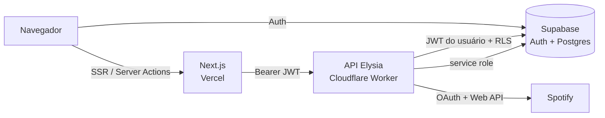

<a id="readme-top"></a>

<!-- PROJECT SHIELDS -->
[![Stars][stars-shield]][stars-url]
[![Issues][issues-shield]][issues-url]
[![Último commit][commit-shield]][commit-url]

<!-- PROJECT LOGO -->
<br />
<div align="center">
  <h3 align="center">📚 NexTrack</h3>

  <p align="center">
    Acompanhe suas leituras: biblioteca, sessões, metas e relatórios — com o Spotify tocando ao lado.
    <br />
    <a href="docs/deploy.md"><strong>Guia de implantação »</strong></a>
    <br />
    <br />
    <a href="https://track.nexsdev.com.br">Acessar o app</a>
    &middot;
    <a href="https://github.com/Pedronex/NexTrack/issues/new?labels=bug">Reportar bug</a>
    &middot;
    <a href="https://github.com/Pedronex/NexTrack/issues/new?labels=enhancement">Sugerir recurso</a>
  </p>
</div>

<!-- TABLE OF CONTENTS -->
<details>
  <summary>Sumário</summary>
  <ol>
    <li>
      <a href="#sobre-o-projeto">Sobre o projeto</a>
      <ul>
        <li><a href="#recursos">Recursos</a></li>
        <li><a href="#construído-com">Construído com</a></li>
        <li><a href="#arquitetura">Arquitetura</a></li>
      </ul>
    </li>
    <li>
      <a href="#primeiros-passos">Primeiros passos</a>
      <ul>
        <li><a href="#pré-requisitos">Pré-requisitos</a></li>
        <li><a href="#instalação">Instalação</a></li>
        <li><a href="#variáveis-de-ambiente">Variáveis de ambiente</a></li>
      </ul>
    </li>
    <li><a href="#uso">Uso</a></li>
    <li><a href="#api">API</a></li>
    <li><a href="#testes">Testes</a></li>
    <li><a href="#implantação">Implantação</a></li>
    <li><a href="#estrutura-do-repositório">Estrutura do repositório</a></li>
    <li><a href="#roadmap">Roadmap</a></li>
    <li><a href="#contribuindo">Contribuindo</a></li>
    <li><a href="#licença">Licença</a></li>
    <li><a href="#contato">Contato</a></li>
  </ol>
</details>

<!-- ABOUT THE PROJECT -->
## Sobre o projeto

O **NexTrack** é um rastreador de leituras multiusuário. Cada pessoa mantém a própria
biblioteca, registra sessões de leitura e acompanha a meta anual em painéis e relatórios.
A integração com o Spotify mostra o que está tocando e controla a reprodução sem sair do app.

O projeto nasceu como um painel pessoal sobre bancos do Notion e hoje roda sobre
Supabase, com isolamento por usuário garantido por Row Level Security (RLS).

<p align="right">(<a href="#readme-top">voltar ao topo</a>)</p>

### Recursos

| Recurso                                                              | Web | Mobile |
| :------------------------------------------------------------------- | :-: | :----: |
| Cadastro e login por e-mail e senha, com captcha (Turnstile)          | Sim | Não    |
| Login com Google e Spotify, vínculo de identidades                   | Sim | Não    |
| Recuperação e redefinição de senha, confirmação de e-mail            | Sim | Não    |
| Biblioteca com filtros, abas por status, grade ou tabela e paginação | Sim | Não    |
| Detalhe do livro: progresso, evolução e histórico de sessões         | Sim | Não    |
| Registro rápido de página e de sessões de leitura                    | Sim | Não    |
| Dashboard: lendo agora, ritmo, números do ano e primeiros passos     | Sim | Não    |
| Relatórios por período: comparação, heatmap e livros concluídos      | Sim | Não    |
| Exportação para CSV                                                  | Sim | Não    |
| Mini player do Spotify (tocar, pausar, avançar, voltar, dispositivos) | Sim | Não    |
| Meta anual e preferências da conta                                   | Sim | Não    |
| Exclusão da conta e dos dados                                        | Sim | Não    |
| Layout responsivo (abas no celular, rail no tablet)                  | Sim | —      |

> [!NOTE]
> O app mobile (`mobile/`) ainda é o projeto inicial do Expo e não consome a API.

<p align="right">(<a href="#readme-top">voltar ao topo</a>)</p>

### Construído com

[![Next.js][Next.js]][Next-url]
[![React][React.js]][React-url]
[![TypeScript][TypeScript]][TypeScript-url]
[![Tailwind CSS][Tailwind]][Tailwind-url]
[![Bun][Bun]][Bun-url]
[![Elysia][Elysia]][Elysia-url]
[![Cloudflare Workers][Cloudflare]][Cloudflare-url]
[![Supabase][Supabase]][Supabase-url]
[![Expo][Expo]][Expo-url]

- **Frontend:** Next.js 16 (App Router, Turbopack), React 19, Tailwind CSS 4, `@supabase/ssr`, Vitest.
- **API:** Elysia sobre Cloudflare Workers, Zod, `jose` (validação de JWT), Bun test.
- **Banco e autenticação:** Supabase (Postgres + Auth), RLS em todas as tabelas, funções SQL para progresso e sessões.
- **Mobile:** Expo 57 com Expo Router (em início).

<p align="right">(<a href="#readme-top">voltar ao topo</a>)</p>

### Arquitetura



- O frontend autentica no Supabase e envia o JWT do usuário para a API.
- A API valida o token e consulta o banco **com o token do usuário**, então o RLS isola os dados.
- A chave `service_role` fica só no Worker: guarda os tokens do Spotify (cifrados com AES-256-GCM) e apaga contas.

<p align="right">(<a href="#readme-top">voltar ao topo</a>)</p>

<!-- GETTING STARTED -->
## Primeiros passos

Siga os passos abaixo para rodar uma cópia local.

### Pré-requisitos

- [Bun](https://bun.sh) 1.4 ou superior
- Um projeto [Supabase](https://supabase.com) (ou a [CLI do Supabase](https://supabase.com/docs/guides/cli) para rodar local)
- Um app no [Spotify Developer Dashboard](https://developer.spotify.com/dashboard) (opcional, para o player)
- Uma site key do [Cloudflare Turnstile](https://developers.cloudflare.com/turnstile/) (captcha dos formulários)

### Instalação

1. Clone o repositório:
   ```bash
   git clone https://github.com/Pedronex/NexTrack.git
   ```
2. Aplique as migrações de `supabase/migrations/` no seu projeto, em ordem de data.
3. Instale as dependências da API e do frontend:
   ```bash
   cd backend && bun install
   ```
   ```bash
   cd frontend && bun install
   ```
4. Configure as variáveis de ambiente (veja a próxima seção).
5. Suba a API local (Wrangler, porta `8787`):
   ```bash
   cd backend && bun run worker:dev
   ```
6. Suba o frontend (porta `3001`):
   ```bash
   cd frontend && bun run dev
   ```
7. Abra <http://localhost:3001> e crie uma conta.

### Variáveis de ambiente

**API** — `backend/.dev.vars` (lido pelo `wrangler dev`; em produção, `wrangler.jsonc` + `wrangler secret put`):

| Variável                    | Descrição                                                    |
| :-------------------------- | :----------------------------------------------------------- |
| `SUPABASE_URL`              | URL do projeto Supabase                                      |
| `SUPABASE_PUBLISHABLE_KEY`  | Chave pública do Supabase                                    |
| `SUPABASE_SERVICE_ROLE_KEY` | Chave de serviço (segredo; nunca vai para o frontend)        |
| `SPOTIFY_CLIENT_ID`         | Client ID do app Spotify                                     |
| `SPOTIFY_CLIENT_SECRET`     | Client secret do app Spotify (segredo)                       |
| `SPOTIFY_REDIRECT_URI`      | Ex.: `http://localhost:3001/spotify/retorno`                 |
| `TOKEN_ENCRYPTION_KEY`      | Base64 de 32 bytes, cifra os tokens do Spotify (AES-256-GCM) |

Gere a chave de cifragem com:

```bash
openssl rand -base64 32
```

**Frontend** — copie `frontend/.env.example` para `frontend/.env.local`:

| Variável                               | Descrição                                       |
| :------------------------------------- | :---------------------------------------------- |
| `NEXT_PUBLIC_SUPABASE_URL`             | URL do projeto Supabase                         |
| `NEXT_PUBLIC_SUPABASE_PUBLISHABLE_KEY` | Chave pública do Supabase                       |
| `API_URL`                              | URL da API (local: `http://localhost:8787`)     |
| `NEXT_PUBLIC_APP_URL`                  | URL pública do app (local: `http://localhost:3001`) |
| `NEXT_PUBLIC_TURNSTILE_SITE_KEY`       | Site key do Cloudflare Turnstile                |

> [!IMPORTANT]
> O build do frontend falha sem `API_URL`. No Supabase, cadastre
> `http://localhost:3001/auth/callback` nas Redirect URLs de Auth.

<p align="right">(<a href="#readme-top">voltar ao topo</a>)</p>

<!-- USAGE -->
## Uso

1. **Biblioteca** — cadastre livros com autor, formato, páginas, ISBN e status
   (`Quero ler`, `Lendo`, `Pausado`, `Concluído`, `Abandonado`).
2. **Sessões** — registre cada leitura com a página final; o progresso do livro se atualiza sozinho.
3. **Dashboard** — veja o que está lendo, o ritmo recente e o avanço da meta anual.
4. **Relatórios** — compare períodos, veja o heatmap de leitura e exporte para CSV.
5. **Configurações** — ajuste a meta anual, métodos de login, conecte o Spotify ou exclua a conta.

<p align="right">(<a href="#readme-top">voltar ao topo</a>)</p>

<!-- API -->
## API

Todas as rotas, exceto `/health`, exigem `Authorization: Bearer <JWT do Supabase>`.

| Método   | Rota                           | Descrição                              |
| :------- | :----------------------------- | :------------------------------------- |
| `GET`    | `/health`                      | Verificação de saúde                   |
| `GET`    | `/books`                       | Lista os livros do usuário             |
| `GET`    | `/books/:id`                   | Detalhe de um livro                    |
| `POST`   | `/books`                       | Cria um livro                          |
| `PATCH`  | `/books/:id`                   | Atualiza um livro                      |
| `PATCH`  | `/books/:id/progress`          | Atualiza a página atual / status       |
| `DELETE` | `/books/:id`                   | Remove um livro                        |
| `GET`    | `/sessions`                    | Lista as sessões de leitura            |
| `GET`    | `/sessions/:id`                | Detalhe de uma sessão                  |
| `POST`   | `/sessions`                    | Registra uma sessão                    |
| `PATCH`  | `/sessions/:id`                | Atualiza uma sessão                    |
| `DELETE` | `/sessions/:id`                | Remove uma sessão                      |
| `GET`    | `/me`                          | Perfil e preferências                  |
| `PATCH`  | `/me`                          | Atualiza perfil e preferências         |
| `DELETE` | `/me`                          | Exclui a conta e os dados              |
| `POST`   | `/spotify/connect`             | Inicia o OAuth do Spotify              |
| `POST`   | `/spotify/callback`            | Conclui o OAuth do Spotify             |
| `GET`    | `/spotify/status`              | Estado da conexão                      |
| `DELETE` | `/spotify/connection`          | Desconecta o Spotify                   |
| `GET`    | `/spotify/currently-playing`   | Faixa atual                            |
| `GET`    | `/spotify/devices`             | Dispositivos disponíveis               |
| `PUT`    | `/spotify/play`, `/spotify/pause` | Tocar / pausar                      |
| `POST`   | `/spotify/next`, `/spotify/previous` | Próxima / anterior               |

<p align="right">(<a href="#readme-top">voltar ao topo</a>)</p>

<!-- TESTS -->
## Testes

```bash
cd backend && bun test
```

```bash
cd frontend && bun run test
```

- `supabase/tests/` — testes SQL de RLS e das funções de progresso. Rodam em transação com
  rollback; execute o conteúdo com `psql` e espere `OK` no fim.
- `scripts/smoke.ts` — smoke test do ambiente publicado com tokens de duas contas.
  Sai com código 0 só se não houver vazamento entre usuários:
  ```bash
  bun run scripts/smoke.ts <API_URL> <TOKEN_A> <TOKEN_B>
  ```

<p align="right">(<a href="#readme-top">voltar ao topo</a>)</p>

<!-- DEPLOYMENT -->
## Implantação

| Parte    | Plataforma         | Domínio                     |
| :------- | :----------------- | :-------------------------- |
| Frontend | Vercel             | `track.nexsdev.com.br`      |
| API      | Cloudflare Workers | `api.track.nexsdev.com.br`  |
| Banco    | Supabase           | —                           |

```bash
cd backend && bun run worker:deploy
```

O passo a passo completo (provedores de login, segredos, Turnstile e checklist de
segurança) está em [`docs/deploy.md`](docs/deploy.md).

<p align="right">(<a href="#readme-top">voltar ao topo</a>)</p>

<!-- STRUCTURE -->
## Estrutura do repositório

```text
NexTrack/
├── backend/            # API Elysia (Cloudflare Worker)
│   ├── src/worker.ts   # entrada do Worker
│   ├── src/routes/     # books, sessions, me, spotify
│   ├── src/auth/       # validação do JWT do Supabase
│   ├── src/spotify/    # OAuth e armazenamento cifrado de tokens
│   └── scripts/        # importação de dados do Notion
├── frontend/           # app Next.js
│   └── src/
│       ├── app/        # rotas: (auth) entrar, cadastrar…; (app) biblioteca, sessoes…
│       ├── features/   # telas por domínio: dashboard, library, reports, settings…
│       ├── components/ # layout, modais e UI base
│       └── lib/        # cliente da API, Supabase, regras de domínio
├── mobile/             # app Expo (em início)
├── supabase/
│   ├── migrations/     # esquema, funções, RLS e grants
│   └── tests/          # testes SQL
├── scripts/smoke.ts    # smoke test de isolamento entre usuários
└── docs/               # implantação, specs e planos
```

<p align="right">(<a href="#readme-top">voltar ao topo</a>)</p>

<!-- ROADMAP -->
## Roadmap

- [x] Migração do Notion para Supabase multiusuário com RLS
- [x] Login com e-mail, Google e Spotify
- [x] Integração com o player do Spotify
- [x] Layout responsivo
- [ ] Remover o servidor legado do Notion (`backend/src/index.ts`)
- [ ] App mobile consumindo a API

Veja as [issues abertas](https://github.com/Pedronex/NexTrack/issues) para a lista completa.

<p align="right">(<a href="#readme-top">voltar ao topo</a>)</p>

<!-- CONTRIBUTING -->
## Contribuindo

Contribuições são bem-vindas.

1. Faça um fork do projeto
2. Crie uma branch (`git checkout -b feat/minha-feature`)
3. Faça commit seguindo [Conventional Commits](https://www.conventionalcommits.org/pt-br/) (`git commit -m "feat(web): minha feature"`)
4. Envie a branch (`git push origin feat/minha-feature`)
5. Abra um Pull Request

<p align="right">(<a href="#readme-top">voltar ao topo</a>)</p>

<!-- LICENSE -->
## Licença

Ainda sem licença definida. Até lá, todos os direitos são reservados ao autor.

<p align="right">(<a href="#readme-top">voltar ao topo</a>)</p>

<!-- CONTACT -->
## Contato

[@Pedronex](https://github.com/Pedronex)

Projeto: <https://github.com/Pedronex/NexTrack>

<p align="right">(<a href="#readme-top">voltar ao topo</a>)</p>

<!-- MARKDOWN LINKS & IMAGES -->
[stars-shield]: https://img.shields.io/github/stars/Pedronex/NexTrack.svg?style=for-the-badge
[stars-url]: https://github.com/Pedronex/NexTrack/stargazers
[issues-shield]: https://img.shields.io/github/issues/Pedronex/NexTrack.svg?style=for-the-badge
[issues-url]: https://github.com/Pedronex/NexTrack/issues
[commit-shield]: https://img.shields.io/github/last-commit/Pedronex/NexTrack.svg?style=for-the-badge
[commit-url]: https://github.com/Pedronex/NexTrack/commits/main
[Next.js]: https://img.shields.io/badge/next.js-000000?style=for-the-badge&logo=nextdotjs&logoColor=white
[Next-url]: https://nextjs.org/
[React.js]: https://img.shields.io/badge/React-20232A?style=for-the-badge&logo=react&logoColor=61DAFB
[React-url]: https://react.dev/
[TypeScript]: https://img.shields.io/badge/TypeScript-3178C6?style=for-the-badge&logo=typescript&logoColor=white
[TypeScript-url]: https://www.typescriptlang.org/
[Tailwind]: https://img.shields.io/badge/Tailwind_CSS-06B6D4?style=for-the-badge&logo=tailwindcss&logoColor=white
[Tailwind-url]: https://tailwindcss.com/
[Bun]: https://img.shields.io/badge/Bun-000000?style=for-the-badge&logo=bun&logoColor=white
[Bun-url]: https://bun.sh/
[Elysia]: https://img.shields.io/badge/Elysia-8B5CF6?style=for-the-badge&logoColor=white
[Elysia-url]: https://elysiajs.com/
[Cloudflare]: https://img.shields.io/badge/Cloudflare_Workers-F38020?style=for-the-badge&logo=cloudflareworkers&logoColor=white
[Cloudflare-url]: https://workers.cloudflare.com/
[Supabase]: https://img.shields.io/badge/Supabase-3FCF8E?style=for-the-badge&logo=supabase&logoColor=white
[Supabase-url]: https://supabase.com/
[Expo]: https://img.shields.io/badge/Expo-000020?style=for-the-badge&logo=expo&logoColor=white
[Expo-url]: https://expo.dev/
